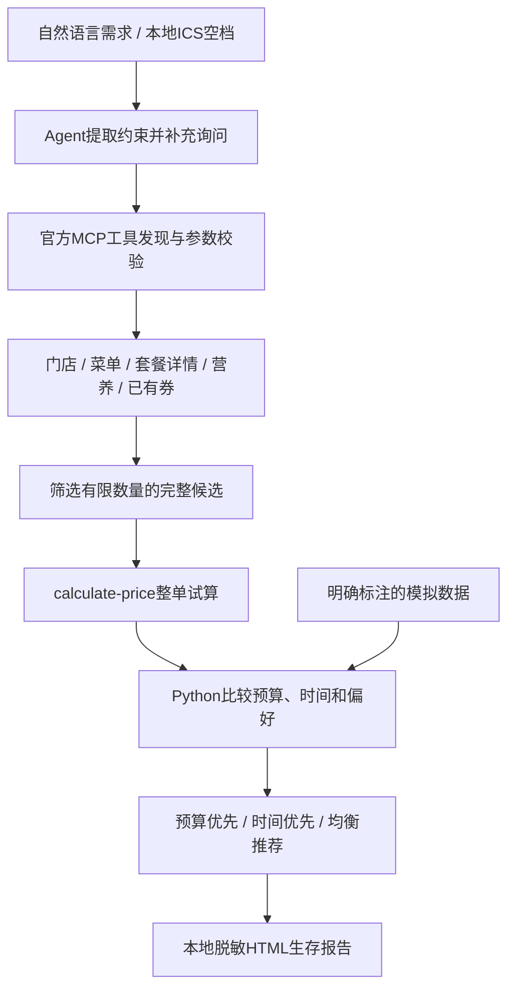

# 下课开麦 / CampusMcD

**下课只有40分钟？让AI帮你算清楚去哪家麦当劳、点什么、花多少钱、来不来得及。**

下课开麦是面向大学生和赶时间人群的开源 Agent Skill。给它一个返课时间、一份预算和饮食偏好，它会结合附近门店、可售餐品与已有优惠券，比较三种用餐方案，再生成一张适合分享的「麦门课间生存报告」。

[在线体验](https://tzb360.github.io/campus-mcd-skill/) · [查看历史核价报告](https://tzb360.github.io/campus-mcd-skill/live-example.html) · [安装为 Skill](#安装为-skill) · [MCP 接入说明](MCP_INTEGRATION.md)

[](https://github.com/tzb360/campus-mcd-skill/actions/workflows/ci.yml)

> 在线演示和下方截图使用模拟数据，无需账号。实时模式通过麦当劳中国官方 MCP 查询与试算，需要在本地配置自己的 Token。历史核价报告标注了采集日期，不代表当前价格。


## 它能帮你做什么

- **安排一段课间。** 把双程步行、排队与出餐估算、用餐时间和返课缓冲一起计算；时间不够时说明原因。
- **比较三种选择。** 预算优先、时间优先、均衡推荐，每种方案都附金额、耗时、余量和推荐理由。
- **核算整单价格。** 使用官方 `calculate-price` 试算完整餐品组合，核验已有券是否适用；有有效的同单对照时才展示节省金额。
- **照顾饮食偏好。** 支持鸡肉等偏好和整餐热量上限。无法可靠匹配营养数据的餐品，不进入限热量推荐。
- **生成课间生存报告。** 保留预算、餐品、金额、时间可行性和趣味称号，默认隐藏门店、精确时段和会员券标识。
- **读取本地课表空档。** 支持已展开的单次 ICS 事件，课表文件不上传。

## 先试三个场景

打开[在线演示](https://tzb360.github.io/campus-mcd-skill/)，选择场景，或调整预算、时间窗口和饮食偏好：

| 场景 | 看什么 |
|---|---|
| 午休90分钟，预算25元 | 比较低预算与短路程的选择 |
| 课间只有25分钟 | 查看时间不足时的说明 |
| 40分钟，鸡肉偏好，700千卡以内 | 查看偏好、热量和返课时间共同约束的结果 |

网页提供40组由同一套 Python 决策内核预计算的模拟状态，不接收位置、会员信息或 Token。

<details>
<summary>查看手机演示截图（模拟数据）</summary>


</details>

## 本地运行

需要 Python 3.11+：

```bash
git clone https://github.com/tzb360/campus-mcd-skill.git
cd campus-mcd-skill
python -m venv .venv
```

激活虚拟环境后安装：

```bash
# macOS / Linux
source .venv/bin/activate
# Windows PowerShell 使用：.venv\Scripts\Activate.ps1

python -m pip install .
campus-mcd demo --scenario chicken
```

打开 `output/survival.html` 查看报告，`output/plan.json` 包含结构化结果。离线演示无需账号或 Token：

```bash
campus-mcd demo --scenario lunch
campus-mcd demo --scenario rush
campus-mcd demo --scenario chicken
campus-mcd demo --request examples/lunch.request.json
```

也可在本地打开交互网页：

```bash
python -m http.server 8765 --bind 127.0.0.1 --directory docs
```

浏览器访问 http://127.0.0.1:8765 。修改决策逻辑后，可运行 `python scripts/build_demo.py` 重新生成网页演示数据。

## 安装为 Skill

在仓库目录运行：

```bash
python scripts/install_skill.py
```

默认安装到 `~/.codex/skills/campus-mcd`；已有目录不会被覆盖。其他支持 `SKILL.md` 的宿主可通过 `--dest` 指定技能目录。让宿主使用已安装本项目依赖的 Python 环境，并加载 [SKILL.md](SKILL.md)。

自然语言理解由 Agent 宿主完成，Python 负责金额、时间和约束比较。可以这样开始：

> 我12点下课，13点半上课，只有25块钱，帮我安排一顿麦当劳。
>
> 附近哪家店有符合我预算的套餐？
>
> 我想吃鸡肉，不想超过700千卡。
>
> 看看我的券，哪套最划算？
>
> 帮我生成今天的麦门生存报告。

缺少地点、日期或关键耗时条件时，Skill 会引导 Agent 补充询问。支持的输入字段与 ICS 用法见[输入说明](docs/input.md)。

## 接入官方 MCP

从[麦当劳 MCP 平台](https://open.mcd.cn/mcp)申请 Token，保存到本机环境变量 `MCD_MCP_TOKEN`，或私有文件 `private/mcd-token.txt`。macOS / Linux 的文件权限须为600；Windows 请使用当前用户专用 ACL。

```bash
# 使用私有文件时，先在本地创建并编辑该文件
chmod 600 private/mcd-token.txt  # macOS / Linux
campus-mcd discover --output private/tools.json
```

由 Agent 将确认后的日期、地点、预算和返课时间写入 `private/request.json`，即可使用到店自取自动规划：

```bash
campus-mcd live-auto --request private/request.json --city 上海 --keyword 你指定的校园或商圈 --walk-minutes 8 12 --wait-minutes 8
```

这里的 `8 12` 是两家候选店的单程步行假设，`8` 是排队与出餐假设，须按实际情况确认。候选顺序来自附近门店查询；不提供耗时估算时，程序不会判断时间可行性。

自动模式最多比较2家营业店、每店3个完整候选，处理单选套餐轮次、默认特调、已有券与门店适用券的交集，并重新整单核价。复杂套餐可由 Agent 使用[自定义调用配方](docs/live-recipe.md)。

完整工具列表、调用流程和配置方法见 [MCP_INTEGRATION.md](MCP_INTEGRATION.md)。[配置示例](mcp-config.example.json)仅包含环境变量占位符；不同宿主的变量展开方式以其文档为准。

## 工作原理



**所需时间 = 双程步行 + 排队与出餐估算 + 用餐 + 缓冲。** 通过预算、时间、热量、可售性和有效期约束后，再按不同策略排序。均衡推荐使用省预算50%、返课余量30%、偏好匹配20%的评分。

金额使用整数分，最终支出来自本次整单试算。只有同店、同商品规格、同取餐方式的有效对照，才用于计算节省金额。空购物篮或商品数量不一致的结果不会被采用。

每次实时流程最多32次业务调用，其中最多12次试算，包含对照。三种策略可能选中同一候选；比较范围限于本次候选，不保证全菜单最优。

## 开发与测试

```bash
python -m pip install -e '.[dev]'
python -m pytest -q
ruff check src tests scripts
python -m build
python scripts/check_release.py
```

83项自动测试覆盖金额、返课时间、营养缺失、优惠券、异常处理、只读边界、报告脱敏、ICS和安装。Windows、Linux、macOS 的 Python 3.11 / 3.12 六项 CI 均已通过。[查看 CI](https://github.com/tzb360/campus-mcd-skill/actions/workflows/ci.yml)

官方 MCP 的8个查询与试算工具已完成真实只读联调。历史案例、数据来源及适配边界见[脱敏联调记录](docs/live-validation.md)；原始会员数据不包含在仓库中。

## 使用边界与隐私

- 步行和出餐耗时依赖确认的估算，没有实时路线或排队服务；未来时段的价格与可售状态需临近出发重新查询。
- 自动适配支持到店自取和每轮单选套餐；复杂组合使用 Agent 配方。个人券查询限第一页、最多200张。
- 营养信息按餐名与规格精确匹配；偏好标签不能替代完整配料或过敏原核验。
- ICS 暂不支持循环事件，遇到未展开的循环课表会明确提示。
- 代码只允许8个查询与试算工具，不创建订单、不自动支付、不领取券或消耗积分。
- Token、精确位置与会员原始数据仅保存在本机私有环境。分享版报告默认隐藏门店、精确时段和券标识，分享前仍应检查内容。

## 参与项目

欢迎通过 [Issue](https://github.com/tzb360/campus-mcd-skill/issues)反馈体验、报告问题或提出功能建议，也欢迎提交 PR。反馈时请提供可复现的场景，并隐藏 Token、券号、精确地点等私人信息。[贡献指南](CONTRIBUTING.md)

如果这个工具对你有帮助，欢迎 Star 或分享[在线演示](https://tzb360.github.io/campus-mcd-skill/)。

本项目参加2026麦当劳程序员创意开发大赛，[报名 Issue](https://github.com/M-China/mcd-developer-innovation-challenge/issues/1294)已提交，接收状态以官方回复为准。

原创代码与视觉使用 [MIT License](LICENSE)。[参赛声明](CONTEST_DECLARATION.md)保留官方原文。本项目为独立开源作品，非麦当劳官方产品；不包含官方商标授权，餐品、营养与价格以官方渠道为准，输出不构成专业营养建议。

## English

**A meal plan that fits between classes.** CampusMcD is an open-source Agent Skill for students and anyone short on time. It combines a budget, a return deadline, meal preferences, explicit travel and waiting assumptions, and quotes from McDonald's China official MCP server.

Compare budget-first, time-first and balanced options, then generate a privacy-friendly HTML survival report. [Try the account-free demo](https://tzb360.github.io/campus-mcd-skill/) with synthetic data, or connect your own local MCP token for live queries and price calculation. Natural-language interaction requires an Agent host; the Python CLI also accepts structured requests. The project is read-only and does not place orders or make payments.
