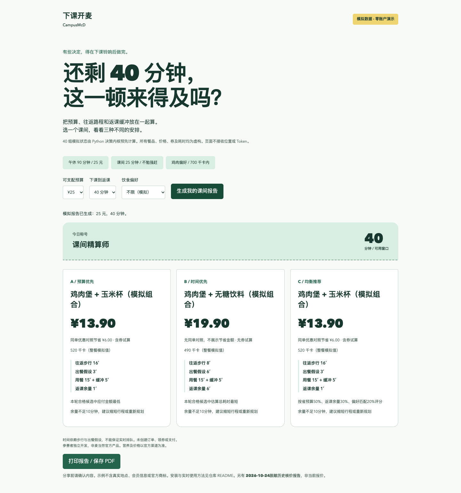
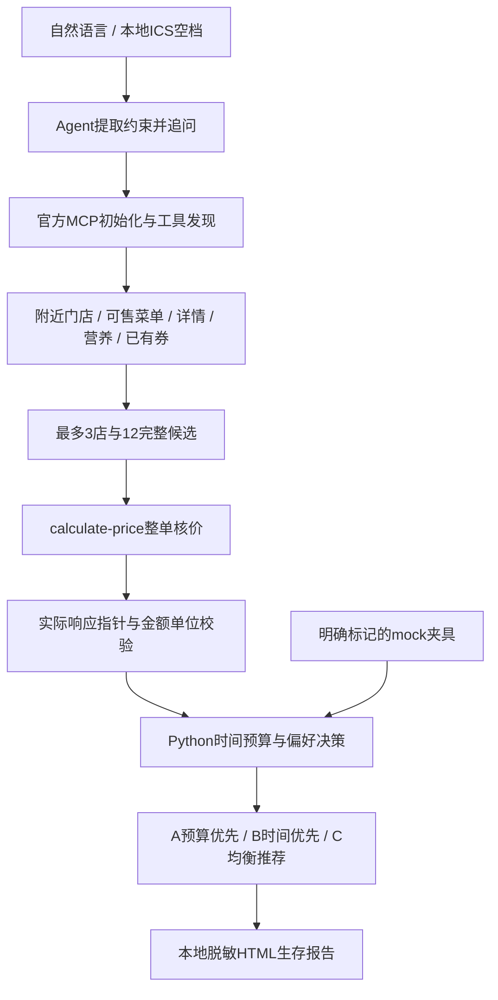
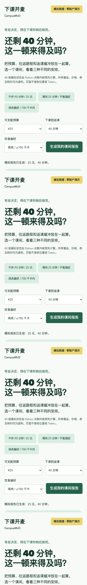

# 下课开麦 / CampusMcD

**下课只有40分钟？让AI帮你算清楚附近去哪家麦当劳、点什么、花多少钱、来不来得及。**

面向大学生和赶时间人群的开源 Agent Skill：把返课截止时间、预算、双程步行和餐品偏好放进同一个决策流程，输出三种方案和一张可分享的「麦门课间生存报告」。

> **当前状态：本地MVP、离线演示及官方MCP只读联调已完成；[Public仓库已创建](https://github.com/tzb360/campus-mcd-skill)，报名Issue正在准备提交，尚无官方审核结果。** 交互演示和主截图均为模拟数据。另提供明确标注日期的[脱敏历史核价样例](docs/live-example.html)，不代表当前报价。



## 30秒看懂

- **先算返课，再看吃什么。** 往返步行、出餐假设、用餐与缓冲都占用时间；25分钟确实不够就不给“来得及”的建议。
- **三种决策可复算。** A预算优先，B时间优先，C均衡推荐。先过硬约束，再比较完整候选；可能选中同一方案，比较范围不等于全菜单最优。
- **实时价格有来源。** 真实模式运行时发现官方MCP schema，整单调用`calculate-price`；没有同单无券对照就不展示“省了多少”。
- **一张能分享的报告。** 默认隐藏门店、精确课表时间与会员券标识，保留预算、餐品、金额、耗时与趣味称号；适合手机截图。
- **免账号体验。** CLI mock模式 + 40组可交互静态模拟状态。自然语言由加载Skill的Agent理解，Python负责金额和时间，不伪装独立聊天模型。

**English:** CampusMcD is a deadline-aware meal-planning Agent Skill for students and anyone short on time. It combines a budget, a return deadline, explicit travel/wait assumptions, preferences and fresh official McDonald's China MCP quotes. It compares budget-first, time-first and balanced options, then creates a privacy-friendly HTML survival report. The demo is entirely synthetic; official account integration is pending a locally configured token.

## 一分钟运行

需要Python 3.11+。在仓库目录中：

```bash
python -m venv .venv
# macOS/Linux
source .venv/bin/activate
# Windows PowerShell改用：.venv\Scripts\Activate.ps1
python -m pip install -e '.[dev]'
campus-mcd demo --scenario chicken
```

打开`output/survival.html`，查看结构化数据`output/plan.json`。不需要账号或Token。所有路径均相对于当前工作目录；也可运行`python scripts/run.py demo`。

三个已实现演示：

```bash
campus-mcd demo --scenario lunch     # 90分钟，25元，比较预算/短路程
campus-mcd demo --scenario rush      # 25分钟，无可行方案，不强行推荐
campus-mcd demo --scenario chicken   # 40分钟，鸡肉偏好，整餐≤700千卡
campus-mcd demo --request examples/lunch.request.json
```

网页体验（同一Python决策内核生成的40组预计算mock状态，无前端Token入口）：

```bash
python scripts/build_demo.py
python -m http.server 8765 --bind 127.0.0.1 --directory docs
```

打开 http://127.0.0.1:8765 ，切换预算、返课窗口和偏好，生成报告。也可直接打开[静态模拟报告](docs/example-report.html)。当前可本地体验；公开仓库为 https://github.com/tzb360/campus-mcd-skill ，在线演示地址待Pages发布后更新。

## 安装为Skill与自然语言使用

```bash
python scripts/install_skill.py
```

默认复制到`~/.codex/skills/campus-mcd`，不会覆盖已存在目录，排除.git、虚拟环境、private、output及.env。执行完成后按提示在所选Python环境安装包。在支持SKILL.md的Agent宿主中加载该目录；其他宿主可用`--dest`指定其Skill目录，自动发现机制以宿主为准。本轮仅验证了隔离目录安装与入口，未声称所有宿主均已验收。

在加载Skill的Agent中说：

- 「我12点下课，13点半上课，只有25块钱，帮我安排一顿麦当劳。」→ 保留时间与预算，追问日期、所在地点及步行/缓冲需求。
- 「附近哪家店有符合我预算的套餐？」→ 补足位置、预算，查询附近门店和可售完整套餐。
- 「我想吃鸡肉，不想超过700千卡。」→ 核验完整餐品，未知整餐热量排除。
- 「看看我的券，哪套最划算？」→ 只查看已有券，以整单带券试算验证，不自动领取。
- 「帮我生成今天的麦门生存报告。」→ 基于已确认条件重算，旧实时报价重新试算。

以上是Skill流程，不是已完成真实账户测试的对话录像。缺少关键参数时追问，不能自动推断用户位置或编造路程/排队。详细输入见[docs/input.md](docs/input.md)。

## 真实MCP配置

从[麦当劳MCP平台](https://open.mcd.cn/mcp)申请Token，只保存在本机环境`MCD_MCP_TOKEN`，或本地`private/mcd-token.txt`。macOS/Linux文件权限须为600，Windows使用本人专用ACL。不要把Token发到聊天、网页、Issue或公开配置。

```bash
# 先在本地编辑private/mcd-token.txt，不要将真实值写入命令历史
chmod 600 private/mcd-token.txt
campus-mcd discover --output private/tools.json
```

已按真实工具发现结果实现到店自取自动适配：

```bash
# request.json由Agent根据你本次确认的位置、日期、预算及返课时间生成
# 8和12是调用者确认的两家候选店单程分钟数，8是排队/出餐假设，不是实时数据
campus-mcd live-auto --request private/request.json --city 上海 --keyword 你指定的校园或商圈 --walk-minutes 8 12 --wait-minutes 8
```

默认最多2家营业店，每店最多3个完整候选；处理套餐轮次、默认特调、已有券交集、TOON营养表精确匹配，整单核价后比较。留空步行或出餐估算时只给价格分析，不宣称时间可行；估算列表按附近门店返回顺序对应，先`call query-nearby-stores`了解候选店，最多2店可用`--store-limit 1`缩为1店。支持的自动套餐为每轮单选；复杂套餐由Agent使用配方处理。无效券/空购物篮不会成为“0元餐”。

高级入口仍可按本轮schema制作自定义配方：

```bash
campus-mcd call --tool query-nearby-stores --arguments private/args.json --output private/stores.json
campus-mcd live --request private/request.json --recipe private/recipe.json
```

每次实时执行都会发现并校验schema、重新试算，生成私有计划/审计及默认脱敏HTML。`live-auto`使用实际联调过的字段适配，`live`由Agent提供来源映射；结构变化时停止，不猜新接口。完整方法见[MCP_INTEGRATION.md](MCP_INTEGRATION.md)和[live配方说明](docs/live-recipe.md)。

宿主配置示例为[mcp-config.example.json](mcp-config.example.json)，仅含`${MCD_MCP_TOKEN}`占位符；不同宿主的环境展开能力需按其文档配置。Python不自动读.env，可用`CAMPUS_MCD_TOKEN_FILE`与`CAMPUS_MCD_TIMEOUT`配置本地文件/超时。

## 架构与工作原理



最短用时 = **双程步行 + 出餐/排队假设 + 用餐 + 缓冲**。缺少确认的耗时就不能判断可行。步行上限、预算、整餐热量、可售状态、有效期是过滤条件；均衡评分使用省预算50%、返课余量30%、偏好匹配20%。最多32次业务调用，其中12次核价（含对照）；不做无界笛卡尔积。

价格用整数分；报告节省仅来自同店、同商品规格、同取餐方式的报价对照。价格5分钟展示策略是项目策略，不是官方锁价。未来时段需在临近出发重新查询。Python静态演示直接复用决策内核，无第二份JS价格算法。

本地ICS入口：

```bash
campus-mcd ics examples/timetable.ics --date 2026-10-24
```

支持已展开的单次VEVENT、时区、全天与重叠事件；MVP遇到循环事件会明确报错，避免漏课。不会上传课表或输出课程名、地点。

## 一次真实只读验收

2026-10-24晚间，以公开校园地标及测试时间/步行假设验收，**不是用户真实位置或课程表**。官方`tools/list`发现35个工具，8个所需查询/试算工具均实际调用成功。最终自动规划执行22次业务调用、8次试算请求，比较6候选，4个满足25元/700千卡及测试时间约束。

例如「精选超值随心配：麦香鸡 + 无糖可口可乐中杯」本轮整单应付**¥13.90**，精确匹配的整餐营养**369千卡**。三种策略本轮选择同一候选，未人为制造差异。2次券专属商品的无券试算返回空购物篮，已拒绝用作节省对照，未展示虚假的“省钱”。以上为历史验收，不锁价、不保证当前可售。原始账户数据只在本机private目录；[公开脱敏记录](docs/live-validation.md)。

## 验证与限制

```bash
python -m pytest -q
ruff check src tests scripts
python -m build
python scripts/check_release.py  # Git仓库提交前的凭据与参赛文件检查
```

本轮macOS / Python 3.12验证：**83项测试通过**，包括本地真实Streamable HTTP协议测试、异常、金额、时间、来源、报告脱敏、隔离安装及异地目录CLI入口。浏览器已实际操作40组模拟状态，在1440/390/320宽度检查，无横向溢出，Console错误与请求失败均为0。截图是浏览器实际导出。CI配置覆盖三个系统及Python3.11/3.12，**远程CI尚未执行，不能声称跨平台全通过**。[详细验收记录](docs/verification.md)

已知限制：自动适配只支持到店自取及单选轮次套餐；没有路线/实时排队服务；自然语言需要Agent宿主；响应映射与完整餐品营养对应仍需Agent核验；最多12候选不保证全局最优；偏好标签不等于过敏原保证；ICS循环尚不支持。没有下单、支付、领券和积分消费能力。

<details><summary>手机演示截图（模拟数据）</summary>



</details>

## 安全、参赛与贡献

代码强制只读8工具白名单；凭据不进入前端、报告或日志，Bearer服务URL固定且不跟随重定向。私人输入/审计默认600权限并被Git忽略；分享HTML默认隐藏位置、门店、精确课程时段与券标识。真实审计不要上传。HTML字段转义，外部返回不被视为Agent指令。

原创代码和视觉使用[MIT许可](LICENSE)；[参赛声明](CONTEST_DECLARATION.md)从官方原样复制，不受本项目改写。官方文档/声明及商标权利属于相应权利方；MIT不授予官方商标或MCP服务的额外使用权。本项目由参赛者独立开发，非麦当劳官方产品，营养信息不构成专业建议。未使用WorkBuddy，不提供虚假开发记录。

[赛事核验与差异化](docs/contest-research.md) · [发布/报名交接](docs/release-checklist.md) · [报名正文草稿](docs/submission-issue.txt) · [传播文案与反馈计划](docs/promotion.md) · [贡献指南](CONTRIBUTING.md)

欢迎用模拟场景提出可复现反馈，特别是时间假设、报告可读性和约束遗漏。请只附脱敏信息。若项目对你有实际帮助，欢迎自愿Star；不组织互刷、不使用机器人或虚假账号。
